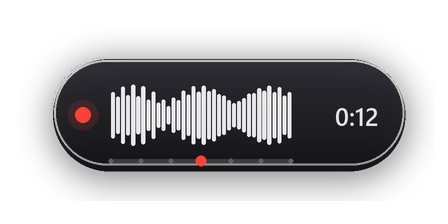
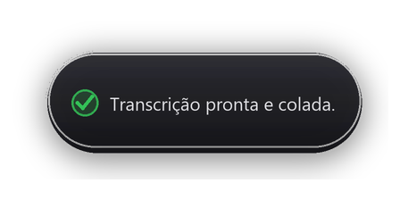

# Dito 1.0 — ditado por voz com CrisperWhisper

**Versão 1.0.0** — primeira versão estável.

<p align="center">
  
</p>

Pílula sempre no topo da tela. Pressione **Ctrl+Y** para começar a
gravar, pressione de novo para parar: o áudio é transcrito com o modelo
CrisperWhisper 2.0 **large** (modo *intended*, que corrige a fala —
remove "ééé", repetições e formata números/datas) e colado no cursor do
programa que estiver em foco ao terminar.

Antes de transcrever, o áudio passa por **corte automático de fala**
(VAD com limiar adaptativo — se ajusta sozinho ao volume da sua
gravação, preservando fala baixa e ignorando ruído). A opção
"Redução de ruído" do painel existe e pode ser desligada quando o
microfone já tiver pouco ruído; em volumes baixos ela pode atenuar a
fala junto com o ruído.

## Capturas

| Parado | Gravando |
|:---:|:---:|
|  |  |
| **Transcrevendo** | **Texto colado** |
|  |  |

## Instalação (Windows 10/11)

Requisitos: Windows 10/11 64 bits, Python **3.11 ou 3.12** e, de
preferência, uma GPU NVIDIA.

```bat
py -3.11 -m venv .venv
.venv\Scripts\activate
python -m pip install --upgrade pip
python -m pip install torch==2.9.1 torchaudio==2.9.1 --index-url https://download.pytorch.org/whl/cu128
python -m pip install -r requirements.txt
python main.py
```

Sem NVIDIA, troque a linha do PyTorch pelo índice de CPU:

```bat
python -m pip install torch==2.9.1 torchaudio==2.9.1 --index-url https://download.pytorch.org/whl/cpu
```

Não é necessário instalar o CUDA Toolkit separado: o PyTorch já traz o
runtime. Só mantenha o **driver da NVIDIA** atualizado.

O `.venv` é local, ocupa cerca de 5 GB e **não deve ser enviado ao
GitHub nem dentro de um ZIP**. Cada pessoa cria o dela; o `.gitignore`
já o ignora.

## Build opcional do executável (desenvolvedores)

O pacote não é distribuído no repositório; o código-fonte é o modo
recomendado. Se um dia quiser gerar o executável, com o `.venv` ativo e o
PyInstaller instalado:

```bat
python -m pip install pyinstaller==6.22.3
powershell -ExecutionPolicy Bypass -File packaging\build.ps1
```

O pacote sai em `dist\Dito\` (onedir, cerca de 4,6 GB). O script gera o
`mic_recorder.exe` separado, copia para a pasta do app e cria o
`SHA256.txt`. O GitHub Releases aceita no máximo 2 GB por arquivo; para
publicar, divida o ZIP em partes ou use uma release com o pacote
hospedado fora do GitHub.

Na primeira abertura, o modelo (~2,9 GB) é baixado do HuggingFace. A
pílula cinza fica girando enquanto carrega; quando ficar verde, está
pronto. Se a GPU falhar, o app cai automaticamente para CPU (mais lento).
A primeira execução pode demorar vários minutos.

## Uso

| Ação | Efeito |
|---|---|
| `Ctrl+Y` | Alterna gravar / parar e transcrever |
| Clique | Alterna gravar / parar |
| Duplo clique | Abre os controles de nível (silêncio/voz) |
| Botão direito + arrastar | Move o quadradinho |
| `copiar` (ao passar o mouse) | Copia a última transcrição para o clipboard |
| `x` (ao passar o mouse) | Fecha o app |
| Rodinha do mouse sobre a pílula | Ajusta a sensibilidade (7 níveis) antes ou durante a gravação |

Em repouso, os 7 pontinhos dentro do círculo mostram a sensibilidade
atual; passe o mouse sobre a pílula e use a rodinha para ajustar. Durante
a gravação, a barra completa aparece embaixo da onda. O ajuste vale só
nesta sessão e volta ao padrão quando o Dito é reaberto. A onda
acompanha o nível escolhido.

A janela é uma pílula escura arredondada no canto inferior direito,
com ondas animadas durante a gravação. O indicador de estado muda de
cor:

- Cinza — carregando modelo
- **Verde** — pronto
- **Vermelho** — gravando
- **Âmbar** — transcrevendo
- Vermelho claro — erro (o texto curto do erro aparece; veja o terminal
  para o erro completo)

Durante o carregamento, a pílula de loading roda em um processo separado
para não travar o app principal.

Enquanto grava, as ondas seguem o nível da voz e o **tempo de gravação**
(m:ss) aparece à direita. Durante a transcrição, o tempo dá lugar a uma
**porcentagem estimada** de progresso — a estimativa se ajusta
automaticamente à velocidade da sua GPU (RTF adaptativo), sem travar em
100% antes da hora.

### Memória da GPU

Áudios de até 30 s são transcritos de uma vez (rápido e estável). Áudios
mais longos são **divididos em trechos de 25–30 s**, cortando
inteligentemente no ponto de energia mais baixo (pausa na fala) dentro
da janela de corte, cada trecho é transcrito separadamente (com as
recuperações de decode ativas, preservando a precisão), a memória do
PyTorch é liberada entre trechos (`torch.cuda.empty_cache()`) e os
textos são unidos no final. Isso evita o modo longform de continuação,
que acumulava VRAM e ficava extremamente lento no Windows.

### Nível de áudio

As ondas usam a captação ao vivo em escala logarítmica com envelope
suave (sobem rápido, descem devagar — sem tremida).

**Duplo clique** na pílula abre o painel de níveis: dois controles
("Silêncio" e "Voz") com medidor ao vivo — fale e ajuste para o ruído
do ambiente ficar abaixo do marcador de silêncio. Os valores ficam
salvos em `dito_config.json`. O ruído e a música baixa abaixo do
nível de silêncio são **ignorados**: só o trecho de fala é transcrito
(corte com histerese e margem suave de 0,35 s nas pontas).

A interface pode ser forçada em `dito_config.json`:

```json
{"ui": "auto", "ui_scale": 0.8}
```

`ui_scale` controla o tamanho da pílula (0,5 a 1,0; menor = menor).
Use `"classico"` em `ui` para voltar ao quadradinho Tk antigo. No modo
`auto`, se a janela nativa em camada falhar, o app cai sozinho no
clássico.

### Colagem no cursor

O app **não troca mais o foco nem restaura janelas**: ao terminar a
transcrição, ele cola no programa que estiver em foco naquele instante.
Se você parar a gravação clicando na pílula e nada externo estiver em
foco, o texto fica no clipboard e a pílula mostra "copiado". Se a
simulação de `Ctrl+V` falhar, ele envia o comando de colar direto ao
campo de texto do programa em foco (WM_PASTE).

Se a transcrição vier vazia, a janela mostra "mic baixo?" ou
"nada entendido", e o áudio é salvo em `dito_ultimo.wav` (sempre o
mesmo arquivo, sobrescrito — nada acumula) junto do registro em
`dito.log`. Áudios com volume baixo são ampliados automaticamente
antes da transcrição (ganho até ×4).

## Troubleshooting

- **Python não encontrado**: instale o Python 3.11 em
  [python.org/downloads](https://www.python.org/downloads/) e marque
  **Add python.exe to PATH**; depois siga as instruções acima novamente.
- **Instalação interrompida ou corrompida**: feche o app, apague a pasta
  `.venv` e repita os comandos acima.
- **PyTorch sem CUDA**: atualize o driver da NVIDIA e repita a instalação
  do PyTorch com o índice CUDA. O `dito.log` mostra o que aconteceu.
- **Mudei a pasta do projeto**: recrie o `.venv` na nova pasta seguindo
  as instruções acima; caminhos absolutos do ambiente antigo deixam de valer.
- **Transcrição lenta**: o modelo roda em fp16 na GPU; frases curtas
  levam < 1 s. Se estiver em CPU, considere trocar `MODEL_SIZE` para
  `"small"` no topo de `dito_app/dito.py`.
- **Apps com `Ctrl+Shift+V`** (ex.: Windows Terminal): o app usa `Ctrl+V`;
  para esses, use o atalho de colar do próprio app ou ajuste a linha
  `keyboard.send("ctrl+v")` para `ctrl+shift+v`.
- **Microfone padrão errado**: mude o dispositivo em
  `Configurações > Som` do Windows.

## Tecnologias

Python 3.11, Tkinter, Pillow, NumPy, PyTorch/CrisperWhisper e chamadas
nativas do Windows via `ctypes` (janela em camada, DPI e foco).

## Licença

O código do Dito está sob a licença MIT (veja `LICENSE`).

O modelo **CrisperWhisper 2.0** não está incluído no repositório e é
baixado na primeira execução; ele tem licença de pesquisa
**não-comercial** (Nyra Health). Consulte a licença do modelo antes de
usar comercialmente.
